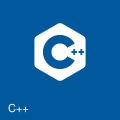
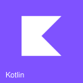
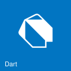
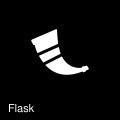
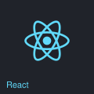
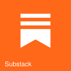

# Hi, I'm Tomasz 👋

**Technical IT Assistant @ Ontario Ministry of Transportation**  
4th Year Computer Science @ Ontario Tech University  
Data Science Specialization | Mathematics Minor

I'm interested in the intersection of software, data, and the real world. I enjoy building practical applications, experimenting with new technologies, and turning interesting ideas into working projects.

Currently exploring **computer graphics, data visualization, and intelligent systems**.

---

### Currently

- 💼 Working as a Technical IT Assistant at the Ontario Ministry of Transportation.
- 🎓 Completing my BSc in Computer Science at Ontario Tech University.
- 🚌 Exploring transit data, GTFS, and real-time passenger information.
- 📝 Completing my undergraduate thesis, visualising and researching invisible interactions in pedestrian trajectory data.

### Areas of Interest

- 📊 **Data Science & Visualization** — Making data easier to understand and explore.
- 🚌 **Transit Technology** — GTFS, real-time transit data, and tools for understanding urban mobility.
- 💻 **Software Development** — Building applications and experimenting with different frameworks.

---

## Tech Stack

### Languages

  
  
  
  
  
  
  
  
  

### Frameworks & Development

  
  
  
  
  

### Data Science & AI

  
  
  
  
  
  

### Tools & Platforms

  
  
  
  
  

---

## Let's Connect!

  
  
  
  
  
  

